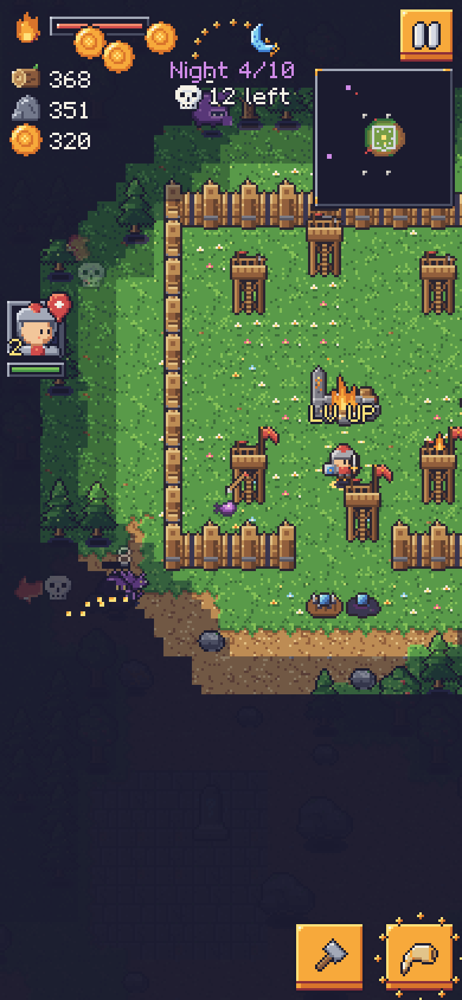

# Emberhold

Mobile portrait game: a squad of pixel-art heroes explores by day, builds a free-form fort on a grid, and defends the Hearth when the Gloom comes at night. Roguelite, 10 nights per run. Engine: COCOS 4 + TypeScript. Full design: [`SPEC.md`](SPEC.md).



## Status
- Done: deterministic core simulation, all content in the SPEC (17 buildings, 6 heroes, 7 enemies + 2 bosses, 24 boons, POIs, meta progression), 591 generated sprites, generated audio, Cocos 4 view layer, web preview, tests, bot balance gates, e2e.
- **Blocked:** the COCOS 4 CLI could not be installed in the environment this was built in, so there is no Cocos scene/build yet and the Cocos layer has never run in the real engine. Details and the unblock steps: [`docs/VERIFY.md`](docs/VERIFY.md).

## Run
```bash
npm install
npm run preview                    # web preview at http://127.0.0.1:4177/  (?debug=1 for window.__EH)
npm run verify -- --allow-blocked  # art, audio, typecheck, tests, balance, preview bundle, e2e
```
Gameplay video: [`docs/video/gameplay.mp4`](docs/video/gameplay.mp4) (re-record with `node tools/verify/video.mjs`).

Individual steps: `npm run art`, `npm run audio`, `npm run typecheck`, `npm test`, `npm run sim:balance`, `npm run e2e`.

## Layout
| Path | Contents |
|---|---|
| `assets/scripts/core/` | Engine-free deterministic simulation (`api.ts` is the contract), data tables, bots |
| `assets/scripts/game/` | COCOS 4 view layer (render, UI, input, audio, saves); `logic/` is engine-free and tested |
| `assets/resources/` | Generated atlas (`art/`) and audio (`audio/`) |
| `tools/art/` | Pixel-art toolkit, sprite generators, manifest, atlas builder |
| `tools/audio/` | sfxr-style synth, chiptune tracker, verifier |
| `tools/preview/` | Canvas2D web preview of the same core + atlas (verification tool, not the shipping client) |
| `tools/verify/` | `verify.mjs` pipeline, Playwright e2e |
| `tests/` | core, balance, art, game |
| `docs/` | `VERIFY.md`, `DECISIONS.md`, `CONTRACT.md`, `shots/`, `art/` |
