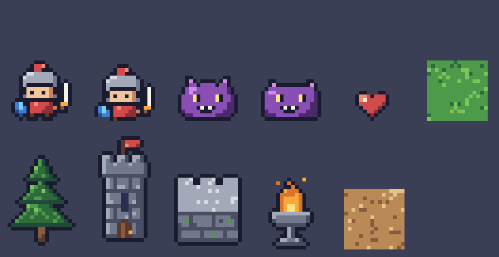

# Emberhold

Game mobile màn dọc: tiểu đội hero pixel-art + xây pháo đài tự do trên lưới + thủ thành theo đêm, roguelite. Engine: COCOS 4 + TypeScript.

Repo hiện chứa **đặc tả và bộ khởi tạo art**, chưa có mã game.

| File | Nội dung |
|---|---|
| [`SPEC.md`](SPEC.md) | Đặc tả đầy đủ: gameplay, game loop, số liệu, art bible, kiến trúc, milestones, Definition of Done |
| [`PROMPT.md`](PROMPT.md) | Một prompt + một goal để agent dựng game từ SPEC, kèm việc cần chuẩn bị |
| [`tools/art/pixel.mjs`](tools/art/pixel.mjs) | Bộ công cụ pixel-art không phụ thuộc: canvas chỉ mục, palette 32 màu, tô bóng, outline, art lint, xuất PNG |
| [`tools/art/anchors.mjs`](tools/art/anchors.mjs) | 11 sprite mẫu định mức chất lượng tối thiểu |
| [`docs/art/style-anchor.png`](docs/art/style-anchor.png) | Ảnh render của các sprite mẫu |



## Chạy thử pipeline art

```bash
node tools/art/anchors.mjs   # Node >= 18, không cần npm install
```

Lệnh render lại `docs/art/style-anchor.png` và chạy art lint.

## Trạng thái kiểm chứng

- Pipeline art: đã chạy, ảnh đã được xem và chỉnh.
- Toolchain COCOS 4 (`cocos-cli` 0.2.0-beta.2, engine 4.0.0-beta.2): các lệnh và hành vi ghi trong SPEC §13.1 lấy từ việc đọc mã nguồn `cocos/cocos-cli`, **chưa được chạy thử**. Mốc M0 của SPEC yêu cầu agent tự kiểm chứng lại trước khi làm tiếp.
